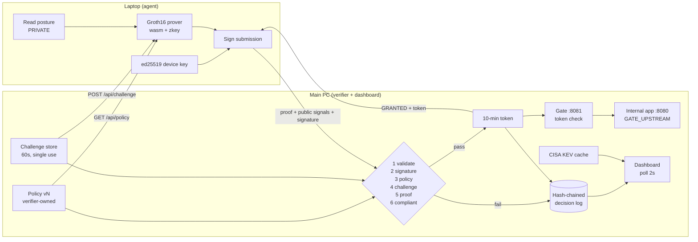

# Architecture

## 1. What crosses the network (and what never does)

| Field | Direction | Leaves the laptop? |
|---|---|---|
| Policy `{version, minBuild, maxUpdateAge, requireFirewall, requireDefender}` | verifier → laptop | n/a (public by design) |
| `challenge` (random, 60 s, single use) | verifier → laptop | n/a |
| Groth16 `proof` (~723 bytes JSON) | laptop → verifier | yes |
| 7 public signals | laptop → verifier | yes |
| ed25519 `signature` over the canonical submission text | laptop → verifier | yes |
| `deviceId` (public-key fingerprint), `policyVersion` | laptop → verifier | yes |
| **OS build + UBR, update age, firewall state, Defender state** | — | **never** |
| Decision + reason code, 10-minute gate token | verifier → laptop | n/a |

The verifier's request schema is strict and rejects unknown fields
(`verifier/lib/validate.js`), so there is no field in which a posture value
could even be smuggled in.

## 2. ASCII diagram (hand-redrawable)

```
        LAPTOP (agent)                             MAIN PC (verifier + dashboard)
  +--------------------------------+        +---------------------------------------+
  | 1 read posture (PRIVATE)       |        |                                       |
  |   registry build+UBR           |        |  policy vN  (verifier-owned)          |
  |   Windows Update history       |        |      |                                |
  |   firewall profiles            |        |      v                                |
  |   Defender status              |        |  challenge store (60 s, single use)   |
  |            |                   |        |      |                                |
  |            v                   | policy |      v                                |
  | 2 Groth16 prover  <------------+--------+----  GET /api/policy                   |
  |   (wasm + zkey, local)         |        |      |                                |
  |            |                   |  chall |      |                                |
  |            v                   | <------+------+  POST /api/challenge           |
  | 3 sign (ed25519 device key)    |        |      |                                |
  |            |                   |        |      v                                |
  |            +--- proof + 7 public signals + signature ---->  POST /api/attest   |
  |                                |        |      |                                |
  |                                |        |      v                                |
  |                                |        |  1 validate                           |
  |                                |        |  2 signature  -> BAD_SIGNATURE        |
  |                                |        |  3 policy     -> POLICY_MISMATCH       |
  |                                |        |  4 challenge  -> REPLAY / EXPIRED      |
  |                                |        |  5 proof      -> PROOF_INVALID         |
  |                                |        |  6 compliant  -> NON_COMPLIANT         |
  |                                |        |      |  pass                          |
  |   10-min token + GRANTED <-----+--------+------+                                |
  |            |                   |        |      +--> hash-chained decision log    |
  |            v                   |        |      |    (no posture values)         |
  | 4 open gate?t=token            +--------+------+--> reverse proxy :8081         |
  |   (browser, not the agent)     |        |      |    GATE_UPSTREAM :8080          |
  +--------------------------------+        |      |                                |
                                            |      +--> dashboard (poll 2 s)         |
                                            |      +--> CISA KEV advisory (admin)    |
                                            +---------------------------------------+
```

## 3. Mermaid diagram



## 4. Components

| Component | Path | Responsibility |
|---|---|---|
| Agent CLI | `agent/index.js` | `enroll`, `check`, `attest`; step output; never prints values; `--interval` repeat |
| TLS client | `agent/lib/tls-verify.js`, `agent/lib/client.js` | Pins the CA public key (SPKI SHA-256), verifies the chain and hostname, refuses on pin mismatch |
| Posture reader | `agent/lib/posture.js`, `agent/lib/posture.ps1` | Fixed PowerShell script, hard timeout, JSON out |
| Prover | `agent/lib/prover.js` | Builds circuit input, `groth16.fullProve`, returns proof + signals |
| Identity | `agent/lib/keys.js` | ed25519 keypair, `deviceId = sha256(SPKI)[0:24]`, sign/verify |
| Local UI | `agent/local-ui.js`, `agent/ui.html` | 127.0.0.1:4000 only |
| TLS / CA | `verifier/lib/tls.js`, scripts | Local CA + leaf (RSA-2048, SHA-256); CA 10 years, leaf 397 days; leaf-only regen; `tls:info`/`tls:leaf`; `trust-ca.ps1` |
| Circuit | `circuits/posture.circom` | 125 constraints, 4 private + 5 public inputs, 2 outputs |
| Verifier | `verifier/server.js`, `verifier/lib/config.js` | The six checks, tokens, admin API, dashboard; HTTPS with generated/loaded cert |
| Gate / proxy | `verifier/lib/gate.js` | Token check, then reverse proxy to `GATE_UPSTREAM` on `GATE_PORT`; `x-forwarded-proto` from the TLS socket |
| Log | `verifier/lib/log.js` | Append-only JSONL + hash chain |
| Advisory | `verifier/lib/kev.js` | CISA KEV fetch, cache, filter |
| Dashboard | `dashboard/*` | Plain HTML/CSS/JS, teal tokens in one file |

## 4b. TLS

TLS is on by default. On first run the verifier generates a local CA and a leaf
into `verifier/data/tls` (git-ignored, keys mode 600). The leaf is regenerated
easily and automatically when SANs change; only the leaf is new, so the CA pin
agents already hold stays the same. `DEMO_INSECURE=1` is the only way to run
plain HTTP.

| File | Contents |
|---|---|
| `ca.key.pem` | CA private key (RSA-2048) |
| `ca.crt.pem` | CA certificate (self-signed, 10-year validity) |
| `leaf.key.pem` | Leaf private key |
| `leaf.crt.pem` | Leaf cert, SANs = LAN IP + hostname + `127.0.0.1` + `localhost`, includes the CA PEM for the chain |
| `leaf-sans.json` | The SAN set that last regenerated the leaf (so a changed IP/hostname triggers a regen) |

The agent pins the CA public key once, via `tlsCaFingerprint` in
`agent/agent.config.json` or `$env:ZKPG_CA_FINGERPRINT` (SPKI SHA-256,
colon/space tolerant). Every TLS connect: verifies the full chain, confirms the
CA is self-signed, checks the leaf signature and not-before/not-after windows, and
checks the hostname (and LAN IP for `127.0.0.1` connections) via `checkHost`/
`checkIP`. A pin mismatch hard-refuses with `TLS refused: the CA fingerprint does
not match the pinned value`; a missing pin refuses with
`TLS is enabled but no valid CA fingerprint is configured...`. `DEMO_INSECURE=1`
is the only bypass.

Do not print or log keys anywhere; only fingerprints ever leave the machine.
The verifier prints the leaf fingerprint and the CA pin at startup.

## 5. The circuit

```
template PostureGate
  private: build, updateAgeDays, firewallOn, defenderOn
  public : minBuild, maxUpdateAge, requireFirewall, requireDefender, challenge
  outputs: compliant, challengeSq
```

Constraints, in order:

1. **Booleans** — `x * (x - 1) === 0` for `firewallOn`, `defenderOn`,
   `requireFirewall`, `requireDefender`.
2. **Range checks** — `Num2Bits(40)` on `build`, `Num2Bits(16)` on
   `updateAgeDays`, so the comparators are sound.
3. **Comparators** — `GreaterEqThan(40)([build, minBuild])` and
   `LessEqThan(16)([updateAgeDays, maxUpdateAge])`. 40 bits covers the encoding.
4. **Boolean requirement** — `ok = 1 - required * (1 - value)`.
5. **Quadratic AND chain** — `and1 = buildOk * ageOk`, `and2 = and1 * fwOk`,
   `compliant = and2 * dfOk`. No constraint has more than two multiplications.
6. **Challenge binding** — `challengeSq <== challenge * challenge`, a public
   output, so it cannot be optimised away. The verifier recomputes
   `challenge² mod p` and rejects a mismatch as `PROOF_INVALID`.

### Build encoding

`build * 100000 + UBR`, e.g. `22631 * 100000 + 3803 = 2263103803`.

```
22631 * 100000 = 2,263,100,000
2,263,100,000 + 3,803 = 2,263,103,803
2^40 = 1,099,511,627,776
2,263,103,803 < 1,099,511,627,776   -> fits in 40 bits
```

Worst case with 5-digit fields: `99999 * 100000 + 99999 = 9,999,999,999`,
still below 2^40. The UBR must stay below 100000 or the encoding would not be
reversible; the agent refuses it instead of guessing.

## 6. Public-signal order (verified from `public.json`)

| Index | Signal | Source |
|---|---|---|
| 0 | `compliant` | circuit output |
| 1 | `challengeSq` | circuit output |
| 2 | `minBuild` | public input |
| 3 | `maxUpdateAge` | public input |
| 4 | `requireFirewall` | public input |
| 5 | `requireDefender` | public input |
| 6 | `challenge` | public input |

## 7. Check order in `/api/attest`

Stops at the first failure and returns its reason code.

| # | Check | Failure code | HTTP |
|---|---|---|---|
| 1 | Input validation (strict schema, no extra fields) | `BAD_REQUEST` | 400 |
| 2 | ed25519 signature over the canonical message | `BAD_SIGNATURE` | 200 |
| 3 | Body policyVersion + public signals match the verifier's policy | `POLICY_MISMATCH` | 200 |
| 4 | Challenge exists, belongs to this device, unused, unexpired | `REPLAY` / `EXPIRED` / `CHALLENGE_DEVICE_MISMATCH` | 200 |
| 5 | Groth16 proof verifies, and `challengeSq` matches | `PROOF_INVALID` | 200 |
| 6 | `compliant == 1` | `NON_COMPLIANT` | 200 |
| ✓ | Issue a 10-minute token, append one log record | — | 200 |

Rate limit exceeded is `RATE_LIMITED` with HTTP 429.

## 8. Signed message format

Canonical JSON = `JSON.stringify` with object keys sorted at every level, arrays
in order, no whitespace, UTF-8 (`shared/canonical.js`).

```
zkpg-attest-v1
deviceId:<deviceId>
challenge:<challenge>
policyVersion:<n>
publicSignals:<sha256(canonicalJson(publicSignals))>
proof:<sha256(canonicalJson(proof))>
```

Signing the digests keeps the message short and stops a middlebox reordering
group elements. The verifier rebuilds exactly these bytes.

## 9. Decision-log canonical form

Fields, in this object:

```json
{ "id": 1, "timestamp": "...", "deviceId": "...", "policyVersion": 1,
  "result": "GRANTED", "reasonCode": null, "latencyMs": 703, "prevHash": "00…0" }
```

```
hash = sha256_hex( prevHash + canonicalJson(fields) )
prevHash of record 1 = 64 zeros
id is the 1-based position in the file
```

`GET /api/log/verify` recomputes the whole chain from disk and reports the first
broken record with a reason: malformed JSON, wrong `id`, `prevHash` mismatch, or
hash mismatch.

## 10. Tokens and sessions

| Token | Format | Lifetime | Used for |
|---|---|---|---|
| Gate token | `gate.<b64url(payload)>.<b64url(HMAC)>` | 600 s | gate port 8081 (httpOnly `zkpg_gate` cookie after first use) |
| Admin session | `admin.<b64url(payload)>.<b64url(HMAC)>` | 8 h | dashboard API |

Payloads carry `exp`; verification uses `timingSafeEqual`. Admin POSTs also
require `x-csrf-token` equal to the session's CSRF value. Cookies are
`HttpOnly; SameSite=Strict; Path=/`. Both lifetimes are environment variables
(`GATE_TOKEN_TTL_SECONDS`, `SESSION_TTL_SECONDS`).

The gate only checks the token. It does not re-read posture, so a laptop that
becomes non-compliant after a successful attestation keeps access until its
token expires — at most one token lifetime (10 minutes by default).

The upstream is fixed at startup from `GATE_UPSTREAM`: http/https only, no
credentials, no query string, optional path prefix. Incoming URLs are parsed
against a fixed dummy base so a protocol-relative path (`//host/...`) is
rejected instead of changing the target. The gate's own cookie is stripped
before forwarding, so the app never sees it.

## 11. Storage (and why not a database)

| File | Contents |
|---|---|
| `verifier/data/policy.json` | versioned policy |
| `verifier/data/devices.json` | deviceId, public key, label, timestamps |
| `verifier/data/enrollment-codes.json` | one-time codes |
| `verifier/data/decisions.jsonl` | append-only hash chain |
| `verifier/data/kev-cache.json` | CISA KEV cache |
| `verifier/data/token-signing.key` | generated HMAC key (mode 600) |

The log is JSON Lines because it can be read and checked line by line, it is
append-only by construction (`appendFileSync`, never UPDATE), and it needs no
native module on the demo machine. It also makes tampering a one-line exercise
that the verifier detects.

## 12. Threats this design addresses — and the gaps

See [THREAT_TABLE.md](THREAT_TABLE.md). Short version: replay, policy drift,
proof forgery, device impersonation, log tampering and over-collection are
handled. A modified agent on a machine without hardware attestation is not.
